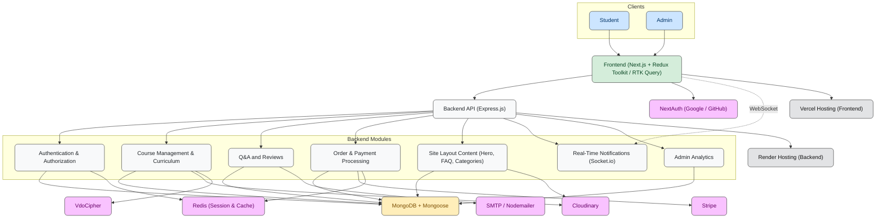
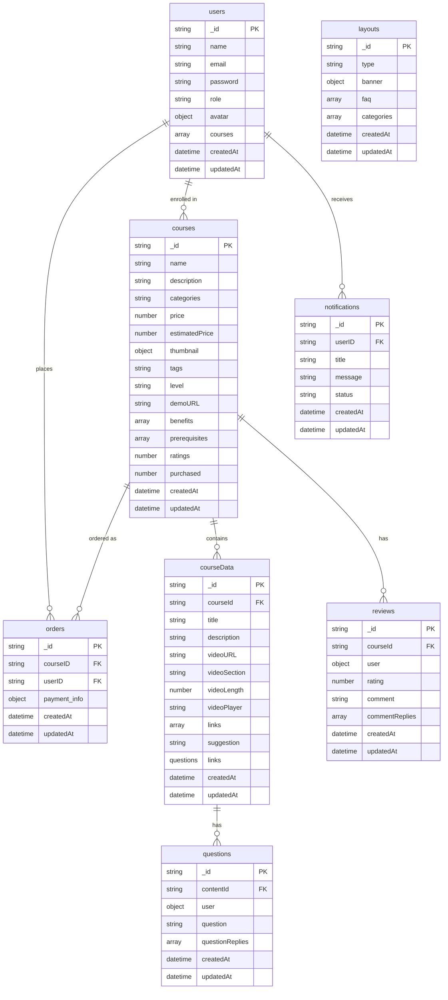
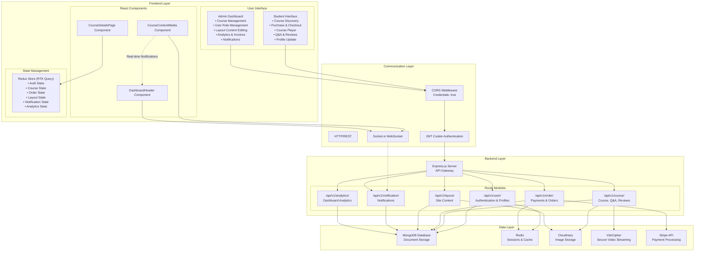
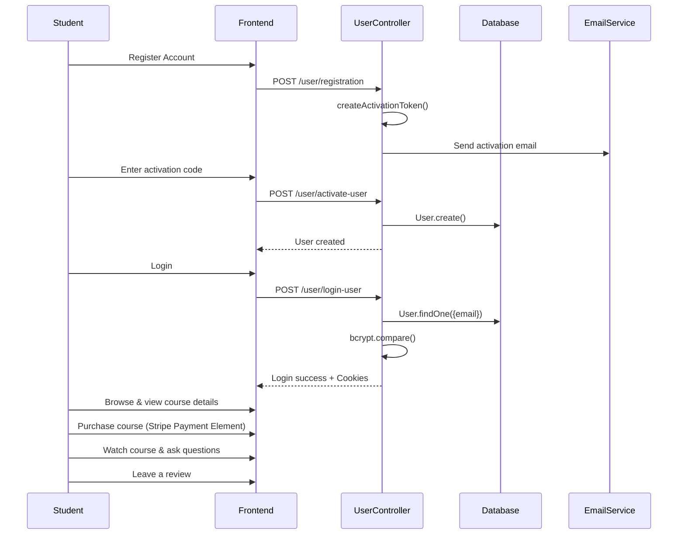
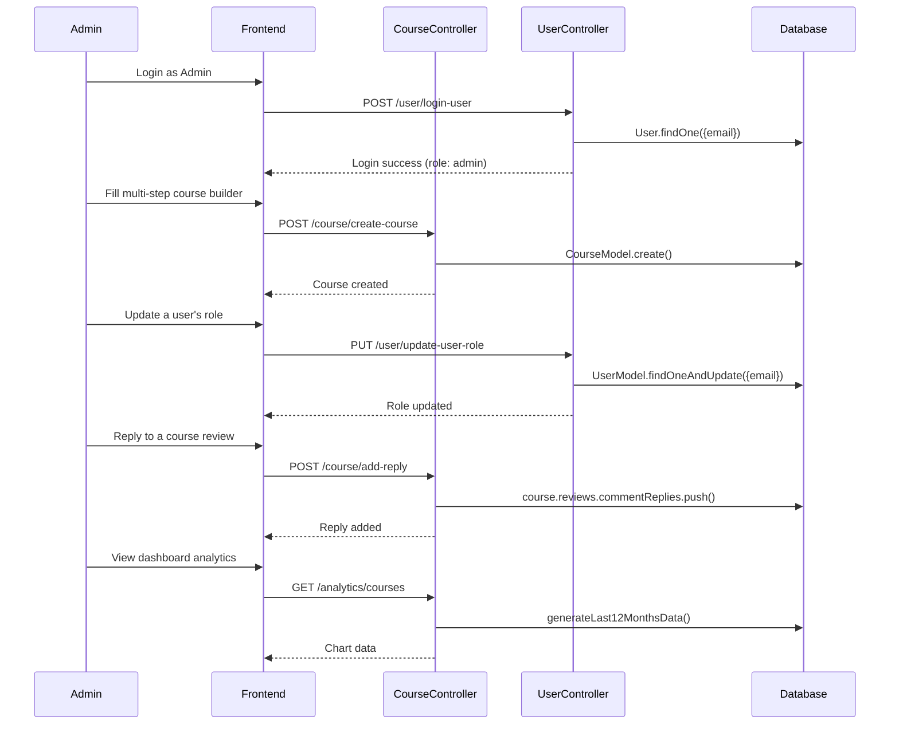
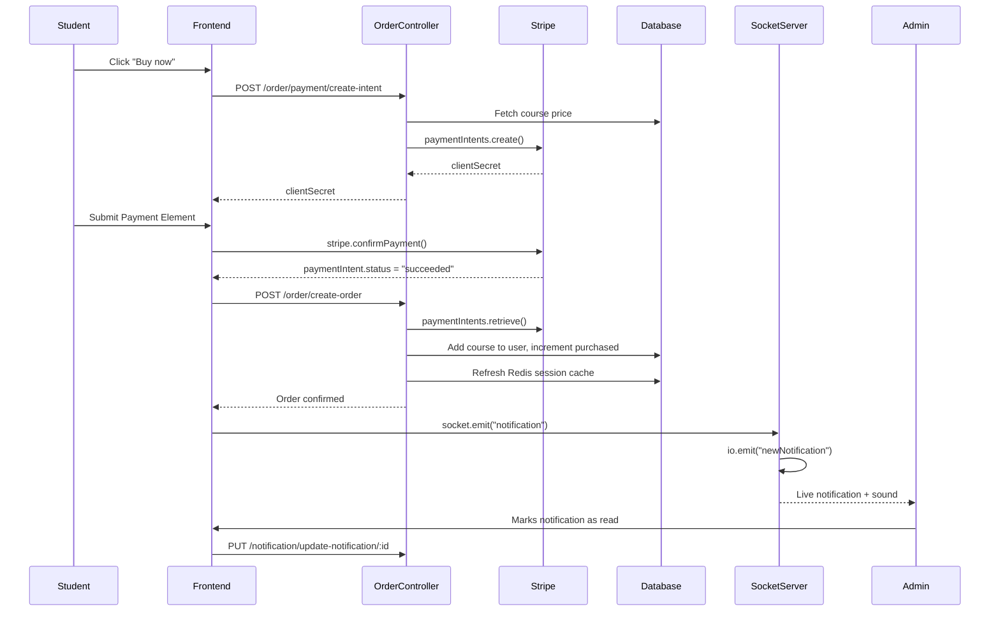

# Case Study - Learning Management System (LMS)

## Overview

Meet **Skillory**.

**Name meaning:**
- **Skill** = the outcome every course is built around
- **-ory** = a place/story of learning, growth, and progress

As per its name, Skillory is a full-stack Learning Management System where students can browse, purchase, and watch expert-led courses, ask questions and leave reviews on lessons, and where admins manage the entire course catalog, users, and platform content from a dedicated dashboard.

## Goals of the Project

The goal of this platform is to provide a complete online learning marketplace — students should be able to discover courses, pay for them securely, watch structured video content, and engage directly with instructors through questions and reviews. Admins should have full control over course creation, user roles, site content (hero, FAQ, categories), and real-time visibility into new orders, questions, and reviews as they happen.

## System Architecture Overview

### System Architecture Diagram

---

## Key Features

### Multi-Role User System

This platform provides two main roles:

- **User (Student)**: Browses and purchases courses, watches lecture content, asks questions per lecture, leaves course reviews, manages their own profile.
- **Admin**: Full dashboard access — course CRUD, user role management, site content editing (hero banner, FAQ, categories), analytics, order/invoice tracking, and replying to student questions and reviews.

### Authentication

- **Email/password auth**: Registration with email activation via a time-limited activation token and OTP-style activation code, login, logout.
- **Social auth**: Google and GitHub sign-in via NextAuth, bridged into the platform's own JWT-based session on first login.
- **Token-based sessions**: Short-lived access tokens paired with longer-lived refresh tokens, both stored as HTTP-only cookies, with server-side session state cached in Redis.
- **Role-based route protection**: Both frontend route guards and backend middleware (`userAuth`, `authorizeRole`) restrict access by role, with a dedicated admin-only middleware chain protecting every dashboard route.

### Course Creation & Management (Admin)

- **Multi-step course builder**: A stepper-driven flow — Course Information, Benefits/Prerequisites, Course Content, and Preview — each step holding its own piece of shared state, assembled into a single payload on submission.
- **Section-based curriculum authoring**: Lectures are grouped into collapsible sections during creation, then flattened into the database's flat lecture-array schema, and re-grouped by section again when rendered for editing or public display.
- **Course editing**: Existing courses can be loaded back into the same multi-step form, including reconstructing the section groupings from the flat stored data.
- **Cloudinary-backed thumbnails**: Course thumbnails and lecture assets upload to Cloudinary, with old images cleaned up on replacement.

### Course Consumption (Student)

- **Public course details page**: Full course info, discount pricing, curriculum preview, and reviews — visible to anyone, purchase-gated for actual video access.
- **Protected course player**: Video playback (via VdoCipher OTP-based secure streaming), lecture navigation, and tabbed Overview / Resources / Q&A / Reviews sections — accessible only to users who purchased the course, or admins.
- **Per-lecture Q&A**: Students can ask questions on any lecture; instructors (or other students) can reply, with email or in-app notification depending on who's replying.
- **Course reviews**: Students who purchased a course can leave a star rating and written review; admins can publicly reply to any review.

### Payments

- **Stripe integration**: An embedded Stripe Payment Element (not a redirect to Stripe's hosted page) collects payment inside the app's own modal, using a server-created PaymentIntent priced from the course document itself — never trusting a client-supplied amount.
- **Order fulfillment**: On confirmed payment, the course is added to the user's account, the course's purchase count increments, a confirmation email is sent, and both the user's session cache and course cache in Redis are refreshed.
- **Webhook as a fulfillment backstop**: A Stripe webhook independently verifies and fulfills orders as a safety net alongside the client-confirmed flow.

### Real-Time Notifications

- **Socket.IO-powered live notifications**: New orders, new questions, and new reviews are broadcast in real time to all connected clients — primarily surfaced on the admin dashboard with a notification sound and unread badge.
- **REST-backed notification history**: Notifications are also persisted to the database and fetched via REST, so the dropdown reflects real history, not just events received while the tab was open.

### Admin Dashboard

- **Analytics**: Bar/area/line charts (via Recharts) for courses, users, and orders created over the last 12 months, computed from rolling 28-day buckets on the backend.
- **Data tables**: MUI DataGrid-powered tables for all courses, all users, and all invoices, each with search, theme-aware styling, and row actions (edit, delete, email).
- **Content management**: Dedicated admin pages for editing the site's hero banner, FAQ list, and course categories — all backed by a single generic layout API keyed by content type.
- **Role management**: Admins can promote or demote any existing user's role by email, without creating a separate account-creation flow.

### Theming & UX

- **Full dark/light mode**: Class-based dark mode (Tailwind v4 `@custom-variant`) driven by `next-themes`, applied consistently across every custom component and third-party UI library (MUI DataGrid, Stripe Elements) via explicit token overrides.
- **Responsive throughout**: Every page and component — header, sidebars, forms, course cards, admin tables, charts — adapts from mobile to desktop with dedicated breakpoint handling rather than a single fixed layout.

### API Architecture

**Auth**
- `/api/v1/user` — registration, activation, login, social auth, logout, profile

**Courses**
- `/api/v1/course` — create, edit, delete, get all, get single, get content, Q&A, reviews

**Orders & Payments**
- `/api/v1/order` — create order, Stripe payment intent, checkout confirmation

**Layout (site content)**
- `/api/v1/layout` — get/edit by type (Banner, FAQ, Categories)

**Notifications**
- `/api/v1/notification` — get all, mark as read

**Analytics**
- `/api/v1/analytics` — courses, users, orders (last 12 months)

### Brand Value Propositions

- **Security**: HTTP-only cookies for all auth tokens, server-side price computation for payments, role-based middleware on every sensitive route.
- **Real-time feel**: Socket.IO notifications and RTK Query cache refetching mean admins and students see updates without manual reloads.
- **Consistency**: A single design token system (`brand`, `accent`, `surface` color scales) applied uniformly across custom UI and third-party libraries alike.

## Tech Stack

### Backend

**Frameworks & libraries**
- **Node.js** with **Express.js** for the API server.
- **MongoDB** with **Mongoose** for data modeling and persistence.
- **JWT** for access/refresh token-based authentication, backed by **Redis** for server-side session caching.
- **Bcrypt** for password hashing.
- **Nodemailer** for activation, order confirmation, and question-reply emails.
- **Stripe** for payment processing (Payment Intents + webhook).
- **Socket.IO** for real-time notification broadcasting, attached directly to the existing HTTP server.
- **node-cron** for scheduled cleanup of old, read notifications.

### Frontend

**Frameworks & libraries**
- **Next.js (App Router)** with TypeScript.
- **Tailwind CSS v4** for styling, with a custom `@theme` token system and class-based dark mode.
- **Redux Toolkit + RTK Query** for global state and all API data fetching/caching.
- **NextAuth.js** for Google/GitHub social authentication, bridged into the app's own JWT session on first login.
- **Formik + Yup** for form state and validation across auth and profile forms.
- **MUI (`@mui/x-data-grid`)** for admin data tables, themed to match the app's design tokens.
- **Recharts** for admin analytics charts.
- **Stripe.js / React Stripe.js** for the embedded payment element.
- **Socket.IO Client** for real-time notification delivery.
- **Lucide React** and **React Icons** for iconography.
- **react-hot-toast** for user feedback messaging.

### File & Media Handling

- **Cloudinary**: Course thumbnails and layout images, with automatic cleanup of replaced images.
- **VdoCipher**: Secure, DRM-protected video hosting and OTP-based playback for course lecture content.

### Development & Deployment Tools

- **Dotenv** for environment variable management across both frontend and backend.
- Nodemon for backend auto-restart during development.
- **Vercel** for hosting the Next.js frontend.
- **Render** for hosting the Express + Socket.IO backend as a persistent web service.

## Challenges & Solutions

| Challenge | Solution |
|---|---|
| Server/client hydration mismatches (theme icons, session-dependent UI, loading states) | Added a `mounted` state flag set inside a `useEffect`, rendering a neutral placeholder until after hydration completes so server and client output always agree on the first paint. |
| Tailwind v4's `dark:` variant defaulting to OS-level `prefers-color-scheme` instead of the app's own theme toggle | Rebound `dark:` to a class-based variant with `@custom-variant dark (&:where(.dark, .dark *));`, matching how `next-themes` actually toggles the theme. |
| SVG fill colors not responding reliably to Tailwind's `dark:` utility classes inside inline SVG | Switched to a plain CSS custom property (`--logo-text`) toggled via `.dark`, applied through an inline `style` attribute instead of a Tailwind class, avoiding SVG-specific specificity issues. |
| `StaticImageData` objects from local image imports being passed directly into a plain `` (expects a string) | Used `next/image`, which accepts `StaticImageData` natively, or unwrapped `.src` explicitly when a plain string was required. |
| Field name casing mismatches between frontend and backend (`videoUrl` vs `videoURL`, `subtitle` vs `subTitle`, `courses` vs `allCourses`) causing silent, no-error data loss | Traced each mismatch by comparing the actual API response shape against what the frontend read, then aligned field names exactly on both sides. |
| Comparing a purchased-course array by its auto-generated Mongoose subdocument `_id` instead of the actual referenced course ID | Rewrote every ownership check to prioritize the real reference field (`item.courseId`) over the always-present but irrelevant `item._id`. |
| `redirect()` from `next/navigation` throwing when called inside Client Component event handlers or `useEffect` | Replaced with `useRouter().push()`, since `redirect()` is only valid in Server Components and Route Handlers. |
| React "Rendered more hooks than during the previous render" error from an early `return` placed between two `useEffect` calls | Moved all hook calls to the top of the component, unconditionally, with the early return only after every hook had run. |
| Next.js 15 making route `params` an async value instead of a plain object | Unwrapped `params` with React's `use()` hook in Client Components (or a plain `await` in Server Components). |
| NextAuth route handler written with Pages Router's default-export convention while the rest of the app used the App Router | Rewrote the handler with named `GET`/`POST` exports at `app/api/auth/[...nextauth]/route.ts`, and removed the leftover conflicting `pages/` directory entirely. |
| RTK Query mutation hooks being called with a `skip` option (a query-only concept), silently never triggering the actual request | Replaced with the correct mutation pattern — destructuring the trigger function and calling it directly inside an event handler. |
| A course-update controller crashing when the client resubmitted the existing `{ public_id, url }` thumbnail object as if it were a new upload | Added a `typeof thumbnail === "string"` check so Cloudinary re-upload only runs for genuinely new images, leaving unchanged thumbnails untouched. |
| Two responses being sent for a single request (`res.json()` called both inside and outside an un-awaited async helper) | Awaited the helper function that owned the response and removed the duplicate `res.json()` call outside it. |
| MUI DataGrid's internal styling not responding to `sx` overrides for dark mode, due to newer versions moving theming into internal CSS variables/specificity layers | Layered `!important` overrides across every relevant DataGrid sub-selector (headers, cells, rows, pagination, icons) to guarantee the override regardless of the installed version's internal implementation. |
| MUI DataGrid throwing a runtime error over missing unique row IDs | Mapped MongoDB's `_id` explicitly to DataGrid's expected `id` field when building row objects. |
| Client-side casing mismatch in Stripe integration (publishable key casing, `client_secret` vs `clientSecret`) preventing Stripe.js from initializing | Standardized casing between backend response and frontend read on both fields. |
| Stripe webhook signature verification failing silently | Registered the webhook route with `express.raw()` before the app's global `express.json()` middleware, since signature verification requires the untouched raw request body. |
| VdoCipher player showing an authentication error when a lecture's video field held an arbitrary URL instead of a real VdoCipher video ID | Clarified that the `videoURL` field must hold a VdoCipher-issued ID from an actual upload, and added guarded error states in the player for invalid/missing IDs. |
| Socket.IO client hard-failing to connect with no fallback, due to `transports` being restricted to `websocket` only | Diagnosed via the browser's failed WebSocket request URL, which revealed a mismatched port between the socket server and the frontend's connection URI; corrected the environment variable to match the backend's actual listening port. |
| Course reviews and replies not appearing on the public course page after being added, despite saving correctly to the database | Identified a 7-day Redis cache on the course document that was never being refreshed after review/reply writes, and added a cache-set call immediately after each successful save. |
| A single mutation performing an add-and-clear action (e.g. clearing a reply textarea) regardless of whether the underlying request actually succeeded | Deferred the clear/reset action until the mutation's own success state confirmed, rather than firing it optimistically on click. |
| An access-control guard on a protected content page checking only "did this user purchase the course," locking admins out of their own review-reply workflow | Added an explicit role check (`role === "admin"`) alongside the purchase check, so either condition grants access. |
| A "production only" server-listen guard (written for a serverless host) silently preventing the server from ever listening on a port after moving to a persistent-process host | Removed the environment-gated guard entirely so `server.listen()` and the database connection always run, regardless of `NODE_ENV`. |

## Database Design

---

## Application Flow Diagram

---

### Student Flow

---

### Admin Flow

---

### Payment & Notification Flow

---

## Best Practices

### Authentication & Security

- **JWT in HTTP-only cookies**: Both access and refresh tokens are stored as HTTP-only cookies, never exposed to client-side JavaScript.
- **Server-side price computation**: Payment amounts are always recalculated from the course document on the backend, never trusted from client input, preventing price tampering.
- **Role-based middleware**: Every admin-only backend route is protected by both authentication and role-authorization middleware, not just frontend route guards.
- **Redis-backed session cache**: User sessions are cached server-side with explicit TTLs, refreshed on every state-changing action (login, order, role update) rather than left stale.

### Component Architecture

- **Shared multi-step form state**: The course creation/edit flow lifts all form state to a single parent component, with each step as a controlled child — avoiding prop drilling issues and keeping the final submission payload assembly in one place.
- **Reusable confirmation and modal components**: A single generic confirmation dialog and modal wrapper are reused across delete actions, login/signup, and checkout, rather than one-off implementations per feature.
- **Consistent theming tokens**: A single `brand`/`accent`/`surface` color system, defined once in the Tailwind theme, is applied identically across custom components and third-party libraries.

### Error Handling & User Experience

- **Toast-based feedback**: `react-hot-toast` surfaces success and error states consistently across every mutation in the app.
- **Loading and empty states everywhere data is fetched**: Every list, table, and chart distinguishes between loading, empty, and populated states rather than rendering blank or broken output.
- **Optimistic-but-verified UI updates**: Actions that affect visible state (marking a notification read, clearing a reply draft) only commit once the corresponding request has genuinely succeeded, not just been triggered.